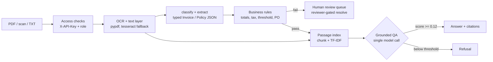

# LedgerLens — Enterprise Financial Document Intelligence

[](requirements.txt)
[](LICENSE)
[](tests/testset.v1.json)
[](app/ocr.py)
[](app/llm.py)

Invoices and finance policy documents in; structured data, cited answers, and human-review routing out.
One shaped model call per question, deterministic everything else, refusal when evidence is insufficient.

## Use cases

| # | Use case | How LedgerLens handles it |
|---|---|---|
| 1 | **AP invoice triage** | Upload a PDF or scan → typed extraction (number, vendor, dates, totals, PO, line items) with required-field flags |
| 2 | **Policy compliance check** | Deterministic rules verify totals match, tax rate within cap, amount under approval threshold, PO present |
| 3 | **Auditor Q&A with evidence** | Ask in natural language → TF-IDF retrieval → answer stitched to cited source passages, or an explicit refusal |
| 4 | **Exception handling** | Any failed rule routes the document to a human review queue; approve/reject requires reviewer authorisation |
| 5 | **Regulated rollout evidence** | Versioned eval set + JSONL logs give latency, cost, and accuracy traces for sign-off |

## Architecture



| Component | File | Role |
|---|---|---|
| API + UI | `app/main.py`, `templates/`, `static/` | Ingest, ask, reviews, metrics endpoints and workbench UI |
| OCR | `app/ocr.py` | pypdf text layer, tesseract fallback for scans, access-checked uploads |
| Extraction | `app/extract.py`, `app/schemas.py` | Regex extraction into Pydantic schemas + required-field checks |
| Rules | `app/rules.py` | Deterministic totals / tax / threshold / PO validation |
| Retrieval | `app/index.py` | Chunking + TF-IDF cosine retrieval with scored citations |
| Model call | `app/llm.py` | Single grounded call: live **Muse Spark 1.3 Free** if `SPARK_API_KEY` is set, else reproducible extractive fallback |
| Ops | `app/store.py`, `app/auth.py` | JSONL logs, latency/cost metrics, API-key + reviewer-role auth |
| Eval | `app/eval.py`, `tests/testset.v1.json` | Versioned test set (extraction, rules, groundedness, refusal, auth) |

## Quickstart

```
pip install -r requirements.txt
uvicorn app.main:app --port 8000   # UI at http://localhost:8000
```

Demo keys: `X-API-Key: demo-key-123` (analyst). Reviewer actions need
`X-API-Key: reviewer-key-456` + `X-Role: reviewer`.
Set `SPARK_API_KEY` to route the single grounded-answer call to the live model;
without it the offline extractive fallback is used (fully reproducible).

## Testing

```
python3 -m app.eval          # versioned eval over tests/testset.v1.json
python3 scripts/bench.py     # serving latency benchmark (see DEPLOYMENT.md)
```

The v1 set has 12 cases across 5 categories: extraction (3), business rules (3),
grounded QA (2), refusal of unanswerable questions (2), authorisation (2).
Eval writes its report to `data/store/eval_last.json`.

### Measured results (2026-10-15, 3 reproducible runs, n=12)

| Metric | Target | Result |
|---|---|---|
| Required-field extraction accuracy | ≥95% | 100% (3/3) |
| Answers with valid source evidence | ≥95% | 100% (2/2 answerable) |
| Correct refusal of unanswerable | ≥90% | 100% (2/2) |
| Test cases with recorded outcomes | 100% | 100% (12/12) |
| Critical tool actions w/o authorisation | 0 | 0 (analyst resolve → 403, verified live) |
| Reproducible evaluation runs | 3 | 3 × 12/12 |

Sample size is 12 and the fixtures are synthetic — these numbers validate the
pipeline, they are **not** a claim of production readiness. Failure categories found
during development (money-group indexing, `Tax (8%)` gap characters, `NoPO`
false-positive) were fixed and are kept as regression cases (E1/E3/R1/R3).
Managed-API vs self-hosted guidance and the measured CPU benchmark live in
[DEPLOYMENT.md](DEPLOYMENT.md).

## Contributing

Issues and PRs welcome. Please keep new extraction rules deterministic and covered
by a case in `tests/testset.v1.json` (bump to `v2` for schema changes), and keep the
model-call surface to the single shaped call in `app/llm.py`.

## License

[MIT](LICENSE)
